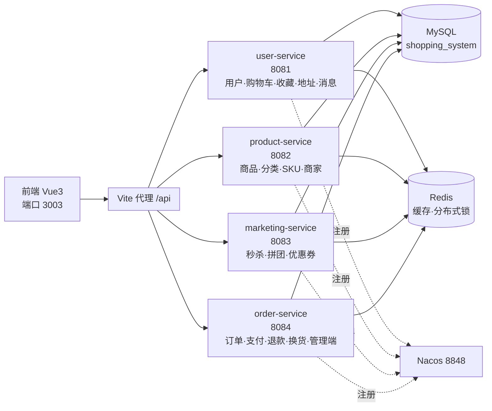

# Shopping System 购物系统

一个基于 **Spring Cloud Alibaba** 的分布式电商系统，包含用户端、商家端、管理端三套界面，覆盖商品、购物车、订单、支付、秒杀、拼团、优惠券、退款换货等完整业务流程。

后端拆分为 4 个微服务，通过 Nacos 完成服务注册与发现；高并发场景（秒杀、库存扣减）使用 Redisson 分布式锁 + Redis 原子操作保证一致性和幂等性。

---

## 技术栈

**后端**

| 类别 | 技术 | 版本 |
|------|------|------|
| 运行时 | Java | 22 |
| 框架 | Spring Boot | 3.3.2 |
| 微服务 | Spring Cloud / Spring Cloud Alibaba | 2023.0.4 / 2023.0.3.2 |
| 服务注册 | Nacos | 2.2.3 |
| ORM | MyBatis-Plus | 3.5.8 |
| 数据库 | MySQL | 8.0 |
| 缓存 | Redis + Redisson | 3.27.1 |
| 鉴权 | JJWT | 0.12.5 |
| 密码加密 | Spring Security Crypto（BCrypt） | — |
| JSON | fastjson2 | 2.0.36 |
| 构建 | Maven | — |

**前端**

| 类别 | 技术 | 版本 |
|------|------|------|
| 框架 | Vue | 3.4 |
| 语言 | TypeScript | 5.4 |
| 构建 | Vite | 5.1 |
| UI | Element Plus | 2.5 |
| 状态管理 | Pinia | 2.1 |
| 路由 | Vue Router | 4.3 |
| 请求 | Axios | 1.6 |
| 图表 | ECharts | 6.1 |
| 样式 | Sass | 1.71 |

---

## 系统架构



### 模块职责

| 模块 | 端口 | 职责 |
|------|------|------|
| `shopping-common` | — | 公共依赖：统一响应、异常处理、JWT 工具、分布式锁注解与切面、Redis 工具、消息抽象层、幂等注解、实体基类 |
| `shopping-user-service` | 8081 | 用户注册登录、会员、购物车、收藏、收货地址、站内消息 |
| `shopping-product-service` | 8082 | 商品列表/详情、分类、SKU 库存、商家入驻与商品管理 |
| `shopping-marketing-service` | 8083 | 秒杀活动、拼团活动、优惠券（平台券 + 商家券） |
| `shopping-order-service` | 8084 | 订单创建与状态流转、支付、物流、退款、换货、订单评价、商家看板、平台管理端 |

---

## 功能清单

### 用户端

- 注册 / 登录 / 个人中心 / 会员信息
- 商品首页、分类浏览、关键词搜索、商品详情（多 SKU 规格）
- 购物车增删改查、收藏
- 收货地址管理
- 下单结算、运费模板计算、支付
- 订单列表与详情、订单评价
- 退款申请、换货申请
- 优惠券领取与下单抵扣
- 秒杀活动、拼团（发起 / 参团 / 成团）
- 站内消息

### 商家端 `/merchant`

- 商家登录（B 端独立登录入口）
- 数据看板：商品数、销量、销售额、订单数
- 商品管理：发布、编辑、上下架
- SKU 库存管理：入库 / 出库
- 订单管理 / 退款管理 / 换货管理
- 营销活动：秒杀、拼团、优惠券

### 管理端 `/admin`

- 管理员登录、角色、权限
- 平台看板
- 用户管理、商家管理
- 商品管理、分类管理
- 订单管理、退款 / 换货审核
- 活动管理、优惠券发放

---

## 核心设计

### 1. 分布式锁

基于 **Redisson + AOP 注解**实现，用注解 `@DistributedLock` 标记方法，切面统一加解锁。

```java
@DistributedLock(key = "'seckill:' + #activityId + ':' + #userId", waitTime = 3, leaseTime = 10)
public void placeSeckillOrder(Long activityId, Long userId) { ... }
```

- Key 支持 **SpEL 表达式**，可直接引用方法参数拼接
- 切面优先级设为 `Ordered.LOWEST_PRECEDENCE - 1`，**高于事务切面**，保证顺序为「加锁 → 开事务 → 执行业务 → 提交事务 → 释放锁」，避免出现"锁已释放但事务未提交"的竞态

### 2. 缓存与限购

| 数据 | Key | TTL |
|------|-----|-----|
| 商品详情 | `product:detail:{id}` | 30 分钟 |
| 秒杀库存 | `seckill:stock:{productId}` | 活动期间 |
| 用户限购 | `seckill:user:limit:{userId}:{activityId}` | 活动期间 |
| 拼团库存 | `group:stock:{activityId}` | 活动期间 |
| 库存锁定 | `sku:lock:stock:{skuId}` | 15 分钟 |

秒杀与优惠券领取都走 **Redis 原子扣减（DECR）**，扣成负数立即回滚，保证不超卖。

### 3. 消息抽象层

`shopping-common/mq` 对消息收发做了抽象，当前实现为本地异步事件 + `mq_message_log` 消息日志表，具备：

- 统一 `MessageSender` 接口，屏蔽具体消息中间件
- 消息投递落日志表，可追踪、可重试
- 同一 Topic 支持多消费者，用 tags 区分

设计上预留了替换为 RocketMQ / RabbitMQ 的入口（把实现类换成 `RocketMQTemplate` 即可）。

### 4. 幂等与鉴权

- `@Idempotent` 注解 + 切面，基于 Redis 令牌防止重复提交
- JWT（JJWT 0.12.5）签发与校验，网关层透传 `Authorization: Bearer <token>`
- 密码统一 **BCrypt** 加密存储，登录用 `PasswordEncoder.matches` 校验

---

## 目录结构

```
ShoppingSystem/
├── backend/                        # 后端 Maven 多模块
│   ├── pom.xml                     # 父 POM，统一版本管理
│   ├── shopping-common/            # 公共模块
│   │   └── src/main/java/com/shopping/common/
│   │       ├── annotation/         # @DistributedLock、@Idempotent
│   │       ├── aspect/             # 锁切面、幂等切面
│   │       ├── config/             # Redisson、Web 配置
│   │       ├── entity/             # 共享实体
│   │       ├── mq/                 # 消息抽象与日志
│   │       └── utils/              # JWT、Redis 工具、统一响应
│   ├── shopping-user-service/      # 用户服务 8081
│   ├── shopping-product-service/   # 商品服务 8082
│   ├── shopping-marketing-service/ # 营销服务 8083
│   └── shopping-order-service/     # 订单服务 8084
├── frontend/                       # 前端 Vue3 + Vite
│   ├── src/views/                  # 用户端页面
│   ├── src/views/merchant/         # 商家端页面
│   └── src/views/admin/            # 管理端页面
├── database/
│   └── init_all.sql                # 数据库建表 + 初始数据（一键初始化）
├── API.md                          # 接口文档
├── FLOW.md                         # 业务流程与消息主题说明
└── README.md
```

> `nacos-server-2.2.3/`、`.uploads/`、`target/`、`node_modules/` 等运行产物已通过 `.gitignore` 排除，不入库。

---

## 本地运行

### 环境要求

- JDK 22
- Maven 3.8+
- MySQL 8.0
- Redis 6+
- Node.js 18+
- Nacos 2.2.3（[官方下载](https://github.com/alibaba/nacos/releases)，单机模式启动即可）

### 1. 初始化数据库

```sql
-- 新建数据库并导入全部表结构与初始数据
mysql -u root -p < database/init_all.sql
```

脚本会自动创建 `shopping_system` 库，并建好用户、商品、SKU、订单、营销等全部表。

### 2. 修改数据源配置

四个服务的 `src/main/resources/application.yml` 中把数据库账号密码改成你自己的：

```yaml
spring:
  datasource:
    url: jdbc:mysql://localhost:3306/shopping_system?useUnicode=true&characterEncoding=utf8&serverTimezone=Asia/Shanghai&useSSL=false
    username: root
    password: 你的密码
  data:
    redis:
      host: localhost
      port: 6379
```

### 3. 启动基础设施

```bash
# Redis
redis-server

# Nacos（单机模式）
# Windows 下进入 nacos/bin 执行 startup.cmd -m standalone
# Linux / macOS：sh startup.sh -m standalone
```

Nacos 控制台：`http://localhost:8848/nacos`

### 4. 启动后端

```bash
cd backend
mvn clean install -DskipTests

# 分别启动四个服务（各自独立进程）
mvn -pl shopping-user-service spring-boot:run
mvn -pl shopping-product-service spring-boot:run
mvn -pl shopping-marketing-service spring-boot:run
mvn -pl shopping-order-service spring-boot:run
```

| 服务 | 地址 |
|------|------|
| user-service | http://localhost:8081 |
| product-service | http://localhost:8082 |
| marketing-service | http://localhost:8083 |
| order-service | http://localhost:8084 |

### 5. 启动前端

```bash
cd frontend
npm install
npm run dev
```

访问 `http://localhost:3003`。Vite 已配置好各业务前缀到四个服务的代理，前端只需请求 `/api/...`。

### 测试账号

| 端 | 账号 | 密码 | 入口 |
|----|------|------|------|
| 用户端 | `user01` | `123456` | `/login` |
| 商家端 | `merchant01` ~ `merchant15` | `123456` | `/merchant/login` |
| 管理端 | 见 `final.sql` 中 admin 表初始数据 | — | `/admin/login` |

---

## 接口文档

- `API.md`：按服务分组的全部 HTTP 接口（路径、参数、返回结构）
- `FLOW.md`：秒杀 / 拼团 / 优惠券 / 库存扣减的完整流程图，以及消息主题定义

统一响应格式：

```json
{ "code": 200, "message": "成功", "data": { ... } }
```

鉴权头：`Authorization: Bearer <token>`
